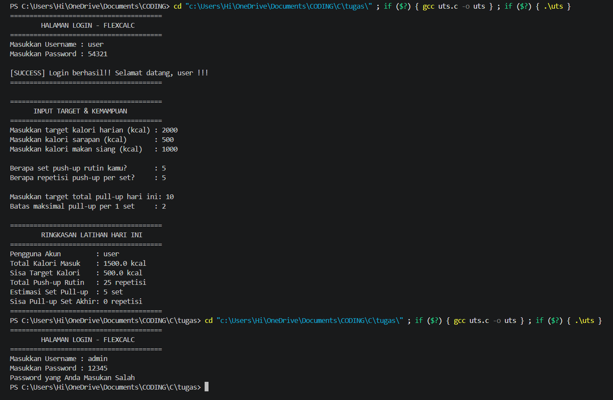
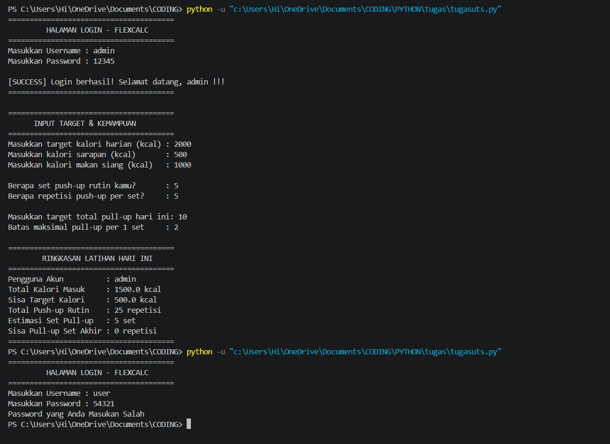

# FLEXCALC

Project Ujian Tengah Semester (UTS) mata pelajaran Pemrograman Dasar / Koding & Kecerdasan Artifisial kelas X PPLG. Aplikasi ini dibuat dalam dua versi bahasa pemrograman, yaitu **C** dan **Python**.

## Identitas Siswa
* **Nama Lengkap:** Muhammad Fadhil Khedira
* **Kelas:** X PPLG
* **No. Absen:** 22

## Deskripsi Aplikasi
FLEXCALC adalah aplikasi berbasis terminal dalam bahasa C dan Python yang berfungsi memantau sisa kuota kalori harian sekaligus merencanakan target latihan push-up dan pull-up harian secara sederhana. Fitur di dalamnya meliputi halaman login sederhana (user / 54321), kalkulator kalori harian berdasarkan target serta kalori sarapan dan makan siang, kalkulator total repetisi push-up rutin dari jumlah set dan repetisi per set, estimator set penuh beserta sisa repetisi set akhir untuk target pull-up berdasarkan kemampuan maksimal per set, serta ringkasan rekapitulasi latihan dan kalori hari ini.

## Daftar File
* `uts.c` : Kode program utama menggunakan bahasa C.
* `tugasuts.py` : Kode program utama menggunakan bahasa Python.
* `outputcfadhil.png` : Screenshot hasil menjalankan program bahasa C.
* `outputpyfadhil.png` : Screenshot hasil menjalankan program bahasa Python.

## Screenshot Output Program
### Output Bahasa C

### Output Bahasa Python

